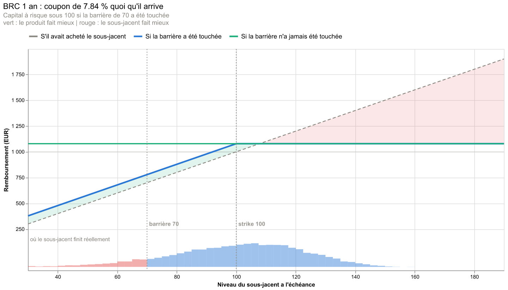
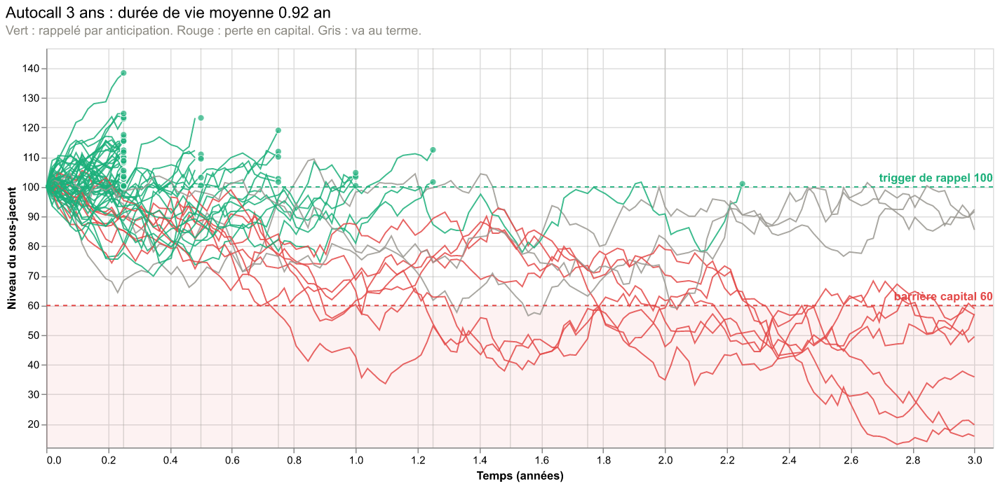
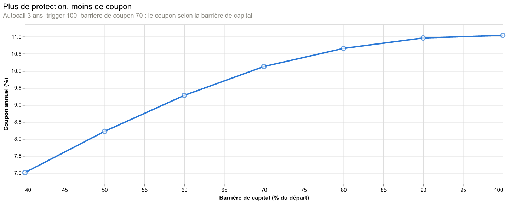

# Sliders Produits Structurés

**Comprendre et vendre des produits structurés en manipulant leurs paramètres.**

👉 **[Ouvrir l'appli](https://sliders-appuits-structures-dmq5ykoul3xvbergzdfnnb.streamlit.app)**

Tom Uzan

---

L'appli calcule ce qu'un desk peut offrir sur sept produits structurés à partir des
conditions de marché. **Rien n'est choisi à la main** : la participation d'un capital garanti
et le coupon d'un BRC ou d'un autocall sont des *résultats*, déduits du budget disponible,
comme le ferait un structureur. On bouge les taux, la volatilité, la barrière ou le spread de
l'émetteur, et l'on voit immédiatement ce qui change pour le client.



## Ce qu'on y trouve

| Page | Ce qu'on y voit |
|---|---|
| **Comparateur** | Les structures principales côte à côte, sous la même vue de marché |
| **Atelier Sales** | Partir de la demande du client (« 8 % de coupon, la barrière la plus basse possible »), voir où va l'argent (marge, rétrocession), revendre en cours de vie, générer un pitch adapté au client |
| **1 à 7** | Tracker, Capital Protection, Barrier Reverse Convertible, Autocall Phoenix (worst-of, step-down, indice à décrément, corrélation de stress, grecques du desk), Bonus, Twin-Win, Discount |
| **Backtest historique** | Le produit émis chaque mois sur l'Euro Stoxx 50 depuis 2000 : rappels, pertes, pire cas |
| **Laboratoire modèle** | Black-Scholes contre Bates, et calibrage sur 122 vrais prix d'options Eurex |
| **Les grecques en mouvement** | La position du desk jour après jour, et l'ordre de couverture à passer |
| **Coût de couverture** | Pourquoi couvrir ne garantit pas un résultat nul |
| **Entraînement** | 40 questions d'entretien de Sales, avec réponse rédigée et démonstration chiffrée |
| **Glossaire** | Le vocabulaire du métier, avec recherche |

Tous les graphes sont interactifs : au survol, une infobulle donne les valeurs à cet endroit.
Les conditions de marché se chargent en un clic (2008, Covid, taux zéro, 2022…), et l'adresse
du site garde tous les réglages : la copier suffit pour partager exactement ce que l'on voit.



## Sous le capot

- **Deux modèles.** Black-Scholes avec skew, simulé en **volatilité locale** (la volatilité
  dépend du niveau atteint), et **Bates** (volatilité stochastique de Heston + sauts de
  Merton), qui génère le skew au lieu de le postuler.
- **Barrières continues** corrigées par pont brownien, **risque émetteur** déduit du spread de
  crédit (avec une option de wrong-way risk), **paniers worst-of** avec corrélation de stress.
- **Données réelles figées dans le dépôt** : Euro Stoxx 50 quotidien depuis 1986 (prix et
  dividendes réinvestis), photo de prix d'options Eurex, paramètres de Bates calibrés.
- Monte Carlo en `float32` et pas hebdomadaires, pour tenir dans l'hébergement gratuit.



Les niveaux affichés sont des ordres de grandeur, pas des prix de marché : un desk recalibre
son modèle chaque matin. La liste des limites du modèle figure en bas de chaque page.

## Lancer en local

```bash
pip install -r requirements.txt
streamlit run app.py
```

## Organisation du code

| Fichier | Rôle |
|---|---|
| `app.py` | Menu des pages et pied de page |
| `barre.py` | Barre latérale : la vue de marché commune à toutes les pages |
| `vues/` | Une page par fichier |
| `moteur.py` | Tout le pricing (simulations, barrières, autocall, grecques…) |
| `sales.py` | Outils du Sales : reverse enquiry, cascade du nominal, marché secondaire |
| `backtest.py`, `calibration.py`, `data/` | Données réelles, backtest et calibrage |
| `graphiques.py` | Graphes interactifs (Altair) |
| `tests/` | Vérification complète, relancée par GitHub à chaque modification |

```bash
python tests/verifie.py
```

Les images de ce README se régénèrent avec `python scripts/captures_readme.py`.
